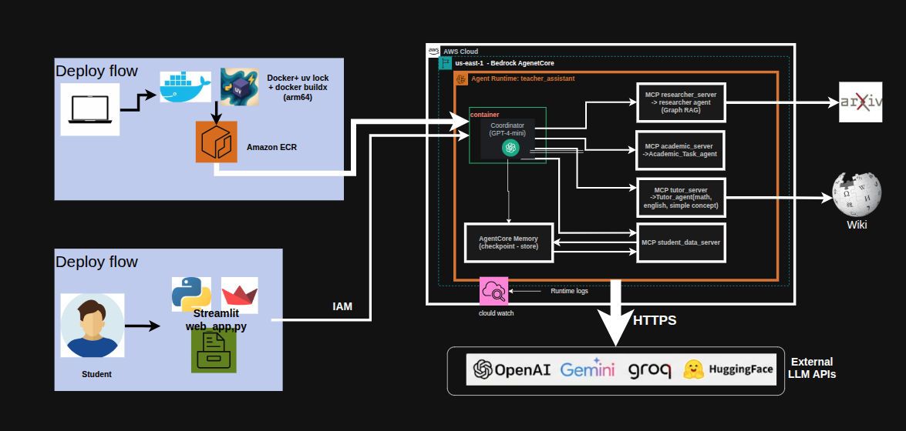

# Education Assistant

A multi-agent study assistant built with **LangGraph** and **MCP**, deployed on **AWS Bedrock AgentCore** with **AgentCore Memory**.
A coordinator agent reads each student request and routes it to specialised agents:

| Agent | What it does | MCP tool |
| --- | --- | --- |
| **Tutor** | Solves math problems step by step and answers English / grammar questions, with the concept explained from Wikipedia | `answer_question` |
| **Academic** | Study plans (planner), study notes (notewrite), exam and workload advice (advisor) | `ask_academic_agent` |
| **Researcher** | Searches arXiv, ranks papers, builds a knowledge graph (Graph RAG) and summarises with citations | `search_arxiv_papers` |
| **Student data** | Reads and updates the student's profile, calendar and tasks | `get_student_profile`, `list_calendar_events`, `list_tasks`, `add_task`, `update_task_status` |





# DEMO:
https://github.com/user-attachments/assets/045553aa-a62d-4296-a51c-52936a36c5c3

## Project structure

```
education_assistant/
│
├── app.py                         # AgentCore entrypoint (POST /invocations, port 8080)
├── web_app.py                     # Streamlit chat UI for the deployed agent
├── Dockerfile                     # linux/arm64 image for AgentCore Runtime
├── pyproject.toml                 # dependencies (uv, CPU-only PyTorch)
├── uv.lock
├── README.md
│
├── MCP/                           # Model Context Protocol layer
│   ├── mcp_config.json            # MCP servers the coordinator starts
│   ├── client/
│   │   └── coordinator.py         # coordinator agent (MCP client) + local terminal chat
│   └── servers/
│       ├── _common.py             # shared helpers (project path, .env, quiet stdout)
│       ├── tutor_server.py        # answer_question
│       ├── academic_server.py     # ask_academic_agent
│       ├── research_server.py     # search_arxiv_papers
│       └── student_data_server.py # profile, calendar, tasks
│
├── memory/                        # AgentCore Memory
│   └── memory_client.py           # checkpointer (short-term), store (long-term), make_config
│
├── subagents/
│   ├── Tutor_agent/               # math + English tutor with Wikipedia concepts
│   │   ├── tutor_agent.py
│   │   ├── tutor_prompt.py
│   │   ├── config_tutor.py
│   │   └── toolagents/
│   │       ├── MathAgent/         # math_agent.py, math_prompt.py
│   │       └── EnglishAgent/      # english_agent.py, english_prompt.py
│   │
│   ├── Academic_Task_agent/       # planner, notewrite, advisor workflow
│   │   ├── academic_main.py       # LangGraph workflow (create_agent_graph)
│   │   ├── coordinator_agent.py
│   │   ├── system_prompt.py
│   │   ├── data_manager.py
│   │   ├── Academic_utils.py
│   │   ├── planner/               # planner_agent.py, planner_prompt.py
│   │   ├── notewrite/             # notewrite_agent.py, notewrite_prompt.py
│   │   └── advisor/               # advisor_ageny.py, advisor_prompt.py
│   │
│   ├── researcher_agent/          # arXiv search, ranking, answer with citations
│   │   ├── research_agent.py
│   │   ├── research_prompts.py
│   │   ├── retrieval.py
│   │   └── config_research.py
│   │
│   ├── Graph_RAG/                 # knowledge graph + vector search over papers
│   │   ├── knowledge_graph.py
│   │   └── config_graph.py
│   │
│   └── test/                      # tutor_test.py, academic_test.py, research_test.py, knowledge_graph.py
│
├── data/                          # sample student data
│   ├── profile.json
│   ├── calendar.json
│   └── task.json
│
├── utils/
│   └── test_api.py                # checks the API keys
│
└── image/

```
# Features of subagents:
## COORDINATOR:
Pick the right tools for each request by using **open-4o-mini**  for coordination:
- researcher tools: finding scientific papers on arXiv
- academic tools: study plans (planner), study notes (notewrite), academic advice (advisor)
- tutor tools: math problems and English/writing/grammar questions, explained with the concept from Wikipedia
- student data tools: reading or changing the student's profile, calendar and tasks
## Tutor agent
### Model using: qwen3.8-27b
1. Concept extraction: 
   + Find the main academic concept in the student's question, so it can be looked up on Wikipedia.
2. Math Agent:
   + Mathematics education assistant include Mathematical Operations, Teaching Tools and Educational Approach.
   + Focus on clarity and systematic problem-solving while ensuring students understand the underlying concepts.
3. English agent:
   + English education assistant include: Writing Support, Analysi(text summarization, Literarym content evaluation and Citation assistance) and Teaching Methods.
   + Focus on being clear, encouraging, and educational in all interactions. Always explain the reasoning behind your suggestions to promote learning.


## Academic agent
### Model using: open-4o-mini
Interlligent multi-agent system that transforms the way student manage their academic life. Create a newrork of specialized AI agent that work together to provide academic support, from autimatic scheduling to intellifgent lectures summarization.

1. Coordinator Agent: Orchestrated the interaction between specialized agent and manages the overall system stage.
2. Planner Agent: Handel calendar interaction with schedual optimization
3. Notewriter Agent: proccess acdemic content and generate study materials
4. Advisor Agent: Provide personalized learning and time management advice.
## Researcher agent
### Model using: gemini-3.1-flash-lite
Finds and explains scientific papers for the student's research question.

1. Query analysis:
   + Based on the user query, decide whether to search arXiv or answer directly.
   + Rewrite the question into several focused search queries (e.g. "recurrent neural networks", "rnn sequence modeling").
2. arXiv search:
   + Search arXiv with each query and collect candidate papers (title, authors, date, abstract, PDF link).
3. Ranking and selection:
   + Score papers by relevance to the original question and keep the top N (default 5).
   + Explain why each selected paper fits the request.
4. Answer with citations:
   + Summarise each paper and write an overview, citing papers as [1], [2]... with arXiv links.
   + Optionally use the Graph_RAG knowledge graph for a deeper, connected answer.

## Graph_RAG

Builds a knowledge graph from the selected papers, so answers combine facts across papers instead of reading each one alone.

1. Entity and relation extraction:
   + Use the LLM to extract key entities (models, methods, datasets, tasks, metrics) and relationships from each paper.
2. Knowledge graph construction:
   + Store entities as nodes and relationships as edges with NetworkX, linking every node to its source paper.
3. Embedding and vector search:
   + Embed nodes with sentence-transformers (all-MiniLM-L6-v2) and find the entry points most similar to the question.
4. Graph traversal and context building:
   + Expand from the entry points to neighbouring entities to collect related facts across papers.
5. Grounded answer:
   + Pass the collected context to the LLM to write an answer where every claim cites its source paper.

# Install and Using

## Requirements

- Python 3.13 and [uv](https://docs.astral.sh/uv/)
- Docker with buildx (for arm64 images)
- AWS CLI v2 configured (`aws configure`) with an IAM user that has
  `BedrockAgentCoreFullAccess`, `IAMFullAccess`, `AmazonEC2ContainerRegistryFullAccess`, `CloudWatchLogsFullAccess`
- API keys: OpenAI, Groq, Gemini, Hugging Face

## Configuration

Create `.env` in `education_assistant/` (no quotes, no spaces around `=`, no trailing spaces):

```
REGION_NAME=us-east-1
MEMORY_ID=<agentcore-memory-id>
MEMORY_STRATEGY_ID=<semantic-strategy-id>
OPENAI_API_KEY=...
GROQ_API_KEY=...
GEMINI_API_KEY=...
HF_TOKEN=...
AGENT_RUNTIME_ARN=<filled in after the first deploy>
```


## Run locally

```bash
uv sync                                   
uv run python -m MCP.client.coordinator   

```

Run the AgentCore server locally:

```bash
uv run python app.py
curl -X POST localhost:8080/invocations -H 'Content-Type: application/json' \
     -d '{"prompt":"Solve 2x^2 - 5x - 3 = 0","user_id":"ABC"}'
```

## Deploy to AWS (first time)

Full step-by-step guide: [`deploy/DEPLOY_STEPS.md`](deploy/DEPLOY_STEPS.md). In short:

1. Create an **AgentCore Memory** in the console (Bedrock AgentCore → Memory) and put its ID in `.env`.
2. Create the runtime role: `bash deploy/create_role.sh`.
3. Build and push the image to ECR:
   ```bash
   aws ecr create-repository --repository-name teacher-assistant --region us-east-1
   aws ecr get-login-password --region us-east-1 | docker login --username AWS --password-stdin <ACCOUNT_ID>.dkr.ecr.us-east-1.amazonaws.com
   docker buildx build --platform linux/arm64 -t <ACCOUNT_ID>.dkr.ecr.us-east-1.amazonaws.com/teacher-assistant:v1 --push .
   ```
4. Create the runtime (console: Bedrock AgentCore → Agents, or `aws bedrock-agentcore-control create-agent-runtime`)
   with the image, the role, network `PUBLIC`, and the API keys as environment variables (not the AWS keys).
5. Copy the runtime ARN into `.env` as `AGENT_RUNTIME_ARN`.

## Update the deployed agent

After changing code or dependencies:

```bash
bash deploy/update.sh
```

It runs `uv lock`, builds and pushes a new tagged image, updates the runtime with the env vars from `.env.docker`,
and waits until it is `READY`. Every update creates a new runtime version behind the same ARN.

## Use the deployed agent

```bash
uv run streamlit run web_app.py   
uv run python client_chat.py      
```

Example questions:

- *Solve the quadratic equation 2x^2 - 5x - 3 = 0 step by step* → Tutor
- *Correct the grammar: "She don't have went to school yesterday"* → Tutor
- *Make me a study plan for my math exam tomorrow* → Academic
- *Search arXiv papers about RNNs* → Researcher

